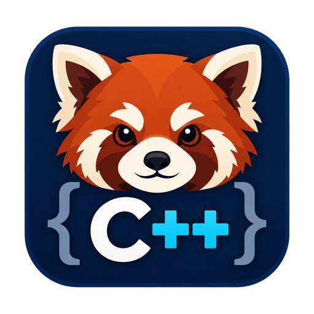

# Red Panda C++

[Italiano](README.it.md) · [Features](docs/FEATURES.md) · [Fork changes](docs/FORK_CHANGES.md)



A C/C++ and GNU assembly IDE with compiler integration, code navigation and debugging. This fork adds a configurable Italian interface, coordinated light and dark themes, richer snippets, searchable preferences, local Italian GCC diagnostics and safer document persistence and recovery.

Based on [RedPanda C++ by Roy Qu and contributors](https://github.com/royqh1979/RedPanda-CPP). The original 3.4 reference and the upstream revision used for this fork are identified in [Fork changes](docs/FORK_CHANGES.md).

## Install

**[Stable release 3.5.1](https://github.com/lellomele/RedPanda-CPP/releases/tag/v3.5.1-rmele.1)** — Windows 10/11 x64.

| Package | Download |
| --- | --- |
| Windows x64 installer | [Download](https://github.com/lellomele/RedPanda-CPP/releases/download/v3.5.1-rmele.1/RedPandaCPP-3.5.1-rmele-Setup-x64.exe) |
| Portable ZIP | [Download](https://github.com/lellomele/RedPanda-CPP/releases/download/v3.5.1-rmele.1/RedPandaCPP-3.5.1-rmele-Portable-x64.zip) |
| Portable EXE | [Download](https://github.com/lellomele/RedPanda-CPP/releases/download/v3.5.1-rmele.1/RedPandaCPP-3.5.1-rmele-Portable-x64.exe) |
| Source code | [Download](https://github.com/lellomele/RedPanda-CPP/releases/download/v3.5.1-rmele.1/RedPandaCPP-3.5.1-rmele-Sources.zip) |
| SHA-256 checksums | [Download](https://github.com/lellomele/RedPanda-CPP/releases/download/v3.5.1-rmele.1/SHA256SUMS.txt) |

Windows x64 packages are available in three formats:

- **Setup EXE:** installs for the current user and adds a Start menu entry; a desktop shortcut is optional.
- **Portable ZIP:** extract the entire folder to a writable location.
- **Portable self-extracting EXE:** extracts the same portable layout without registering an installed application.

Start **`RedPandaIDE.exe` in the main folder**. The internal IDE is `app/RedPandaIDE-core.exe`; keep the complete `app` folder. Qt and its runtime dependencies are included. Configure **GCC/Clang** and **GDB/LLDB** separately to build and debug your programs.

**Separate compiler download:** [WinLibs x64 UCRT, GCC 16.1.0, POSIX/SEH](https://github.com/brechtsanders/winlibs_mingw/releases/tag/16.1.0posix-14.0.0-ucrt-r4) — [ZIP](https://github.com/brechtsanders/winlibs_mingw/releases/download/16.1.0posix-14.0.0-ucrt-r4/winlibs-x86_64-posix-seh-gcc-16.1.0-mingw-w64ucrt-14.0.0-r4.zip) · [7z](https://github.com/brechtsanders/winlibs_mingw/releases/download/16.1.0posix-14.0.0-ucrt-r4/winlibs-x86_64-posix-seh-gcc-16.1.0-mingw-w64ucrt-14.0.0-r4.7z). Includes GDB and Make. Extract the complete archive to a separate folder, then add its `mingw64/bin` directory in the compiler settings. No system-wide PATH change is required. This external distribution has not yet been validated with this fork; an existing compatible compiler can also be used.

Setup and the portable extractor require an empty destination. To update an installed copy, uninstall it first; personal settings are retained. For a portable update, preserve `app/config` and restore it into a freshly extracted copy. Packages are unsigned. See [Windows installation and packaging](docs/WINDOWS_DISTRIBUTION.md).

## Use

Open a source or project, configure a compiler in **Tools > Options**, then compile, run or debug.

- **Appearance:** select interface language, a coordinated theme and an icon family. Restart after changing language.
- **Preferences:** use **Ctrl+F** to find a page; pending edits can be saved, discarded or left open by cancelling navigation.
- **Snippets:** manage and filter snippets, import/export collections and expand a prefix with **Ctrl+Alt+Space**. The shortcut is configurable; Tab moves between placeholders.
- **GCC diagnostics:** with the Italian interface, the Issues panel and tooltips share the local translation while keeping the original message. Unrecognised messages remain unchanged.
- **Clean Build Artifacts:** preview known outputs and select what to move to the Recycle Bin. Custom Makefiles have a separate `clean` command.
- **Recovery and resilience:** enable periodic recovery snapshots and open the recovery folder or diagnostic log.

See [Features and workflows](docs/FEATURES.md) for theme names, snippet syntax, diagnostic coverage and cleanup behaviour.

## Configuration and limits

Installed builds keep settings in the user profile; portable packages use `app/config`. Recovery restores text into new, unsaved documents without overwriting originals. Atomic source saves require write permission for a temporary file in the destination directory.

Recovery is best-effort: native crashes, memory corruption, unavailable storage and power loss may require restarting and recovering the last valid snapshot. Save important work regularly. Cleanup covers recognised build outputs and requires operating-system Recycle Bin support. Italian diagnostic translation covers a finite catalog, not every compiler message. See [Recovery, reliability and operational limits](docs/FORK_CHANGES.md#robustness-and-error-resilience).

Project builds use Make timestamps. Use **Rebuild All** when files were copied with older timestamps or changed within the toolchain’s timestamp resolution.

Windows may delay native process creation. A close request waits up to eight seconds for workers; if they have not stopped, closure is cancelled and documents remain open.

The officially validated distribution targets **Windows x64 with Qt 6.11.2**. Qt 5 code paths are retained as secondary compatibility; they are not a release requirement.

## Build from source

Requirements: C++17, CMake 3.19+, Qt 6.8+ or Qt 5.15, and matching compiler/Qt architecture. Qt modules: Core, Concurrent, Gui, Widgets, Network, PrintSupport, Svg, Xml, Test and LinguistTools. The Windows distributions use Qt 6.11.2 and MinGW-w64. Other platform/toolchain combinations require validation for this fork.

```sh
cmake -S . -B build -DCMAKE_BUILD_TYPE=Release -DVCS=ON -DLUA_ADDON=ON -DSDCC=ON -DCMAKE_PREFIX_PATH=/path/to/Qt
cmake --build build --parallel
cmake --build build --target all-test-targets --parallel
ctest --test-dir build --output-on-failure
```

See [BUILD.md](BUILD.md) for upstream build routes and [Windows packaging](docs/WINDOWS_DISTRIBUTION.md#building-distributions) for this fork's installer and portable layout.

See [Testing and editing measurements](docs/TESTING.md) for isolated application checks and repeatable benchmarks.

## License and copyright

GNU GPL version 3 or later: [LICENSE](LICENSE), [FORK_NOTICE.txt](FORK_NOTICE.txt). Original authors and contributors retain their copyrights; third-party components retain their respective licenses.

Fork attribution: **Copyright © 2026 Ing. prof. Raffaele Mele (lellomele@gmail.com)**, also shown in About beside the original credits.
